<div align="center">


# Mira

**A local-first personal AI desktop workspace**

Bring conversations, project files, a terminal, a browser, and tool execution into one window. Let AI agents help you organize information, research, write, and code.

[简体中文](README.md) · **English**

[](https://github.com/ChatWw/Mira-Harness/releases)
[](LICENSE)

[](https://github.com/ChatWw/Mira-Harness/stargazers)

[Download](#getting-started) · [Features](#features) · [Architecture](#architecture) · [Development](#development) · [Roadmap](#roadmap) · [FAQ](#faq)

<br />

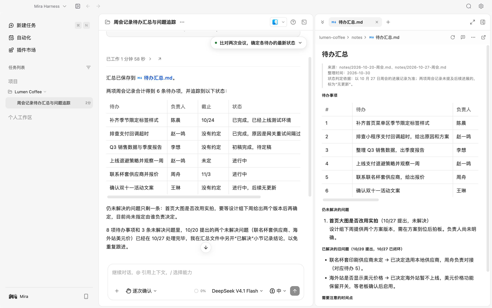

</div>

## Overview

Describe your goal, choose a model and permission mode, and let the agent work through the task using files, the terminal, the browser, and plugins. Start with a plan when needed and review approval requests according to your permission settings. Follow execution, stop at any time, or return to an earlier conversation to continue.

Conversations, configuration, memory, and run history stay on your computer. Connect an online model provider or use local Ollama models.

- **Work in one window**: Keep the file tree, code and document previews, terminal, and embedded browser beside your conversation.
- **Follow execution**: See plans, tool calls, file changes, and approval requests in the conversation, with support for reverting file changes.
- **Extend capabilities**: Enable plugins, Skills, Hooks, custom agents, and MCP servers for your projects.
- **Automate repeated work**: Turn multi-step tasks into scheduled workflows and keep each run's outputs.

## Features

### Tasks and agent collaboration

Organize conversations by project and group. Review plans, tool calls, file changes, and approval requests in the conversation. Delegate complex work to subagents running in parallel, and stop execution at any time.

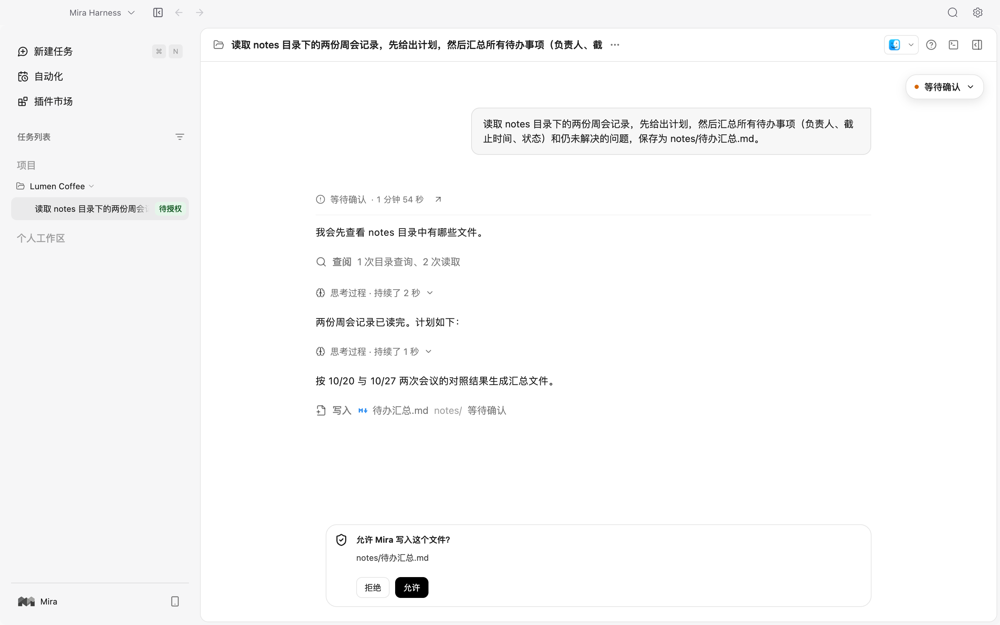

### Files, terminal, and browser

Browse, search, and edit project files alongside your conversation. Inspect Git changes, open a terminal, or let the agent interact with pages in the embedded browser.

<table>
  <tr>
    <td width="50%">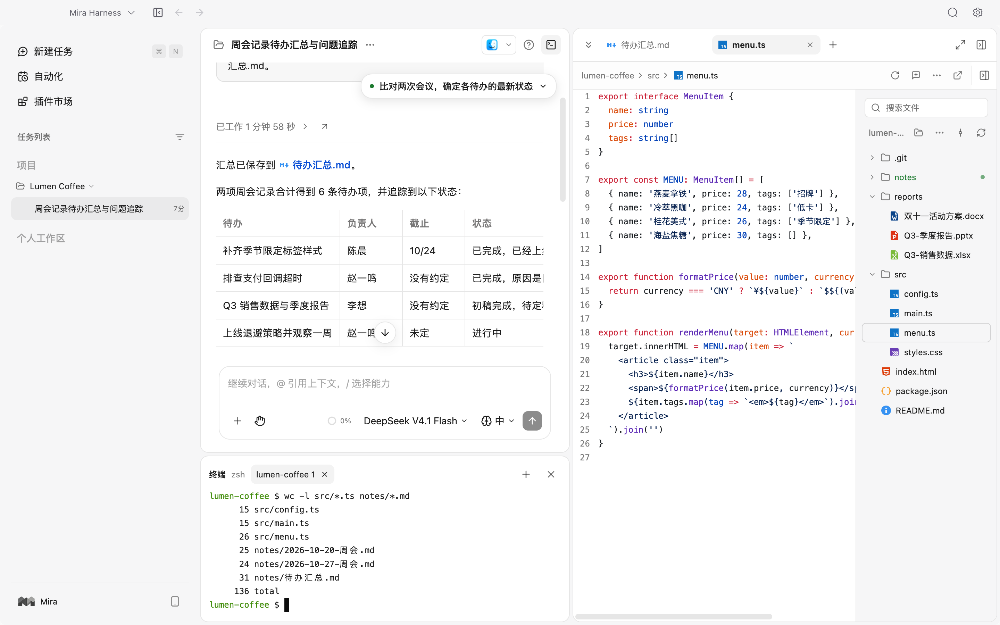</td>
    <td width="50%">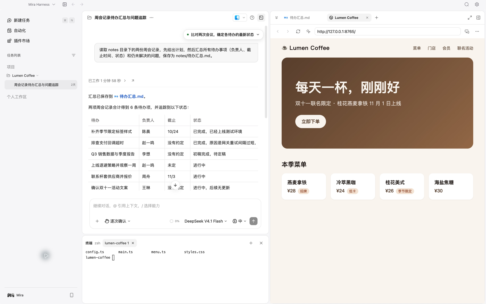</td>
  </tr>
  <tr>
    <td align="center">File tree, code previews, and Git changes</td>
    <td align="center">Embedded browser and terminal</td>
  </tr>
</table>

### Document preview and processing

Preview PDFs, Word documents, Excel spreadsheets, and PowerPoint presentations. Use document plugins to create or revise content.

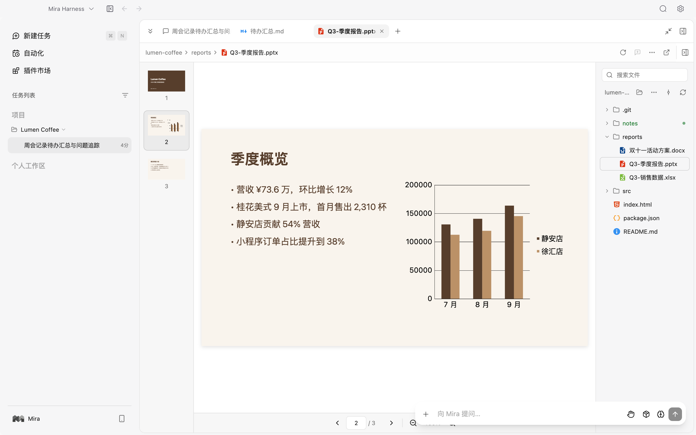

### Workflows and automation

Turn tasks such as “read the sources, extract key points, and write a report” into repeatable workflows. Schedule runs and review their history and outputs.

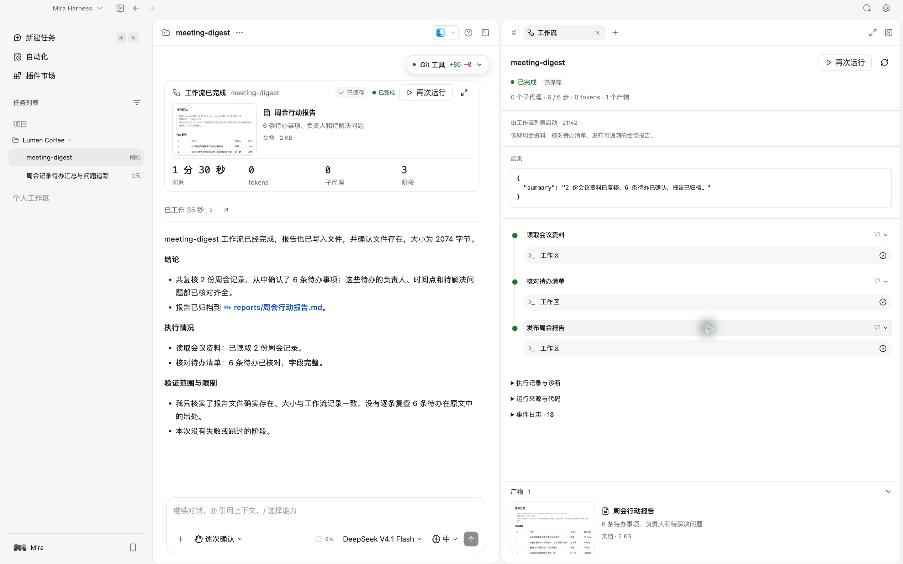

### Multiple model providers

Connect online providers, custom compatible endpoints, or local Ollama models, and choose a model for each task. Supported protocols include OpenAI Completions, OpenAI Responses, and Anthropic Messages; availability depends on the provider and model.

<table>
  <tr>
    <td width="50%">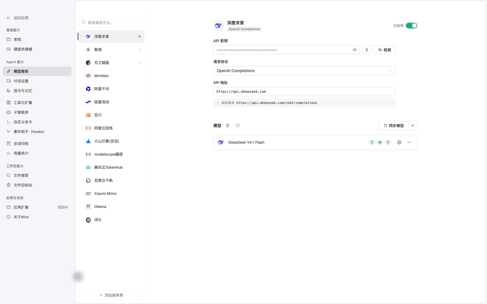</td>
    <td width="50%">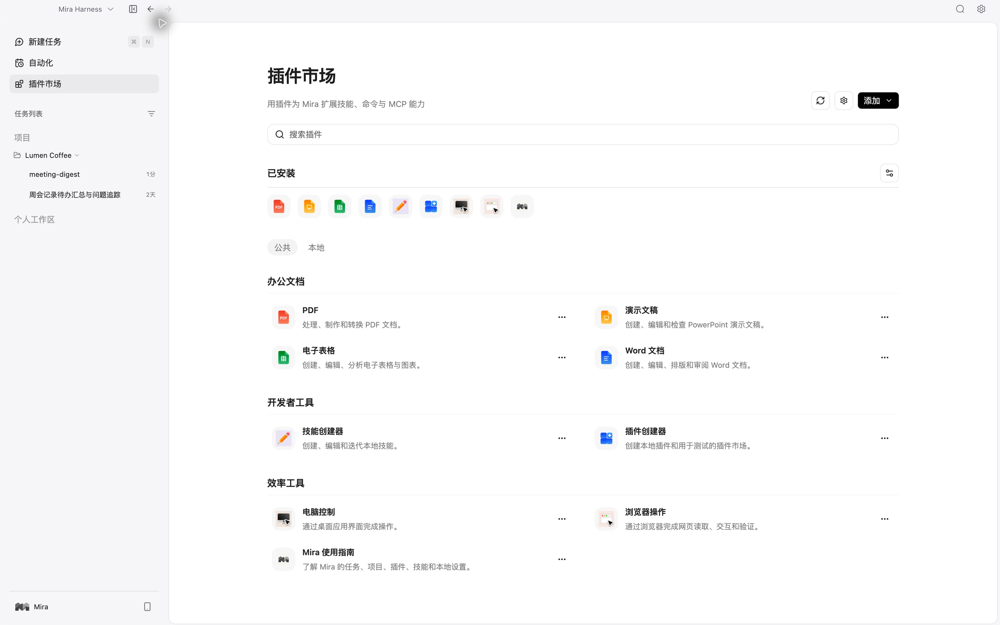</td>
  </tr>
  <tr>
    <td align="center">Model service configuration</td>
    <td align="center">Plugin marketplace and MCP</td>
  </tr>
</table>

### Plugins, Skills, and MCP

Install Skills, commands, agents, and Hooks through the plugin marketplace, or connect external MCP servers. Bundled plugins cover PDFs, Word documents, spreadsheets, presentations, browser interaction, and computer control.

### LAN remote chat

Continue project conversations from a phone or another computer's browser on a trusted local network. Your desktop still executes the tasks. This feature is off by default.

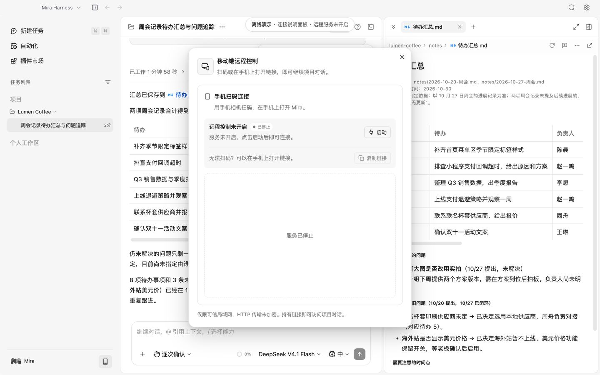

*Offline demonstration of the connection panel. The remote service is not running in this screenshot.*

## Getting started

### Download and install

Get an installer from [GitHub Releases](https://github.com/ChatWw/Mira-Harness/releases).

| Platform | Architecture | Package |
| --- | --- | --- |
| macOS | Apple Silicon (arm64) | DMG |
| Windows | x64 | NSIS installer |

Check each release's attached assets for the platforms actually available. If no installer is available, [run from source](#development).

### Start your first task

1. Open **Settings → Model services** (`设置 → 模型服务`), add a provider or local Ollama endpoint, and enable the model you want to use.
2. Add a project folder or create a task in your personal workspace.
3. Choose a model and permission mode, then describe your goal.
4. Follow the plan and execution, respond to approval requests, and continue the conversation after reviewing the result.

Try a task like one of these:

> Read the meeting notes in this project, extract action items, owners, and open questions, and save them as a Markdown document.

> Trace how this repository starts up and find its configuration entry points. Propose a change plan and wait for my approval before editing.

> Turn “read the sources, extract key points, and write a report” into a repeatable workflow, keeping the output of each run.

PDF, Office, and browser plugins may require additional Python libraries or a browser. Check the plugin instructions before enabling them. Computer control on macOS requires Accessibility and Screen Recording permissions.

## Architecture

Electron's main process holds Mira's execution capabilities and data. The interface handles presentation and interaction, accessing host capabilities through controlled channels. It cannot access model API keys or the full preload API directly.

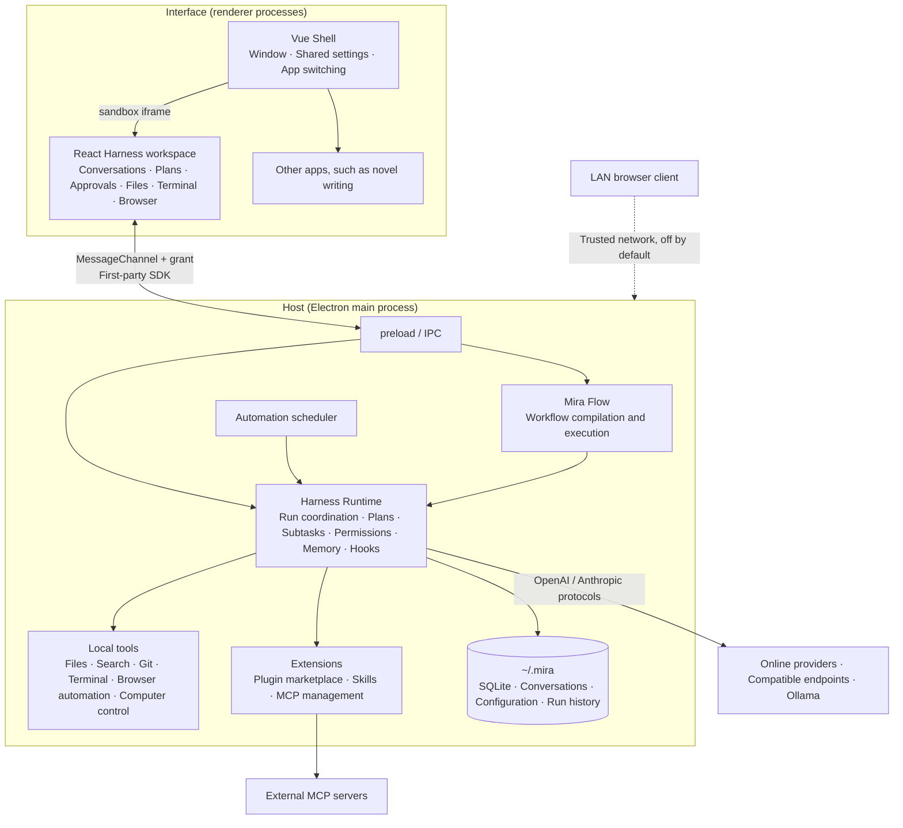

### How a task runs

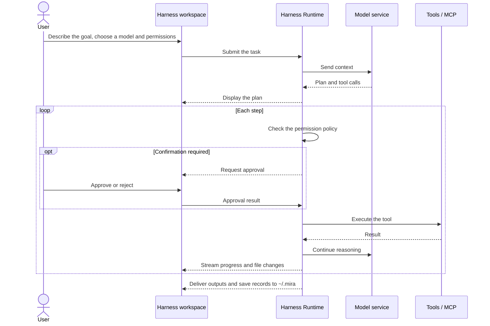

### Technology stack

| Layer | Technologies |
| --- | --- |
| Desktop host | Electron · TypeScript · better-sqlite3 · node-pty |
| Workspace | React 19 · Tailwind CSS 4 · Radix UI · xterm.js · Shiki |
| Shell and settings | Vue 3 · Pinia · Element Plus · Wujie |
| Agents and extensions | pi-agent-core · Model Context Protocol SDK |
| Document preview | pdf.js · docx-preview · pptx-renderer |
| Build and test | electron-vite · Vite · electron-builder · Vitest |

### Directory structure

```text
apps/harness-react/    React workspace, LAN client, and host bridge
electron/              Main process, preload, IPC, execution, and storage
src/                   Vue shell, settings, novel pages, and shared contracts
packages/              Workflow compiler (mira-flow-kit) and runtime (mira-flow-runtime)
resources/             Bundled plugins and runtime resources
scripts/               Build and installation preparation scripts
tests/                 Regression tests
docs/                  Capability and interface documentation
third-party-licenses/  Third-party licenses, notices, and source records
```

## Data and privacy

- **Stored locally**: Conversations, configuration, memory, and run history are stored in `.mira` under your home directory. Project files stay in the folders you choose.
- **Your configured model provider**: Online model requests send task-related messages, attachment content, or tool results to the corresponding provider. With local Ollama, model requests do not go to an external model service.
- **External tools when enabled**: Plugins and MCP servers may access networks or other applications. Their data handling depends on the tools you enable.
- **Execution follows your permission mode**: In the default mode, built-in file tools require approval to modify files or read outside the working directory. Other modes follow the selected policy. Commands and MCP tools use their own approval mechanisms; these controls are not an operating-system sandbox.

LAN remote chat is off by default. When enabled, connect using the QR code or link provided by the desktop app; model calls and task execution remain on your computer. Connections use unencrypted HTTP, and anyone with the link can access project conversations. Use it only on a trusted local network and stop the service when finished.

## Development

**Mira Harness** is the engineering name of this repository; **Mira** is the application name.

**Requirements**

- Node.js **22.12 or later** and npm.
- On macOS, Xcode Command Line Tools to compile the computer-control helpers.
- Build Windows installers on Windows. Native dependencies require the corresponding platform's build toolchain.

```bash
git clone https://github.com/ChatWw/Mira-Harness.git
cd Mira-Harness
npm install
npm run dev
```

The development command builds the React workspace, workflow runtime, and local tools before starting Electron. After editing the React workspace, run `npm run harness:build` and refresh the desktop page.

<details>
<summary><b>All commands</b></summary>

| Command | Purpose |
| --- | --- |
| `npm run dev` | Prepare resources and start Electron in development mode |
| `npm run build` | Run Vue / React type checks and the full production build |
| `npm test` | Run Vitest regression tests |
| `npm run desktop:build` | Build and verify an ad-hoc signed macOS arm64 DMG for local testing |
| `npm run desktop:release` | Build a Developer ID signed and Apple-notarized macOS arm64 release DMG |
| `npm run desktop:build:win` | Build a Windows x64 NSIS installer on Windows |
| `npm run harness:build` | Rebuild the React workspace and remote client |
| `npm run flow:build` | Rebuild the workflow compiler and runtime |
| `npm run tools:build` | Prepare search tools and computer-control helpers |

The installer commands include type checks and the production build. Local tools are prepared for the target platform and architecture during packaging.

See [macOS signing and release](docs/MACOS_RELEASE.md) for certificate setup, build commands, and notification acceptance checks (Chinese).

</details>

## Roadmap

- [x] Harness workspace: conversations, plans, approvals, subagents, files, and terminal
- [x] Multiple model providers: online services, compatible endpoints, and local Ollama
- [x] Plugin marketplace, Skills, Hooks, and MCP
- [x] Workflow editor and scheduled automation
- [x] LAN remote chat
- [ ] Complete Windows installer acceptance testing
- [ ] Integrate Mira Novel Studio
- [ ] Mira Vision

## FAQ

<details>
<summary><b>Can I use Mira without sending data to an online model provider?</b></summary>

Yes. Connect local Ollama in **Settings → Model services** to keep model calls on your computer. Some plugins and MCP servers may still access the network.

</details>

<details>
<summary><b>Which models are supported?</b></summary>

Connect providers, self-hosted endpoints, or local Ollama models with OpenAI Completions, OpenAI Responses, or Anthropic Messages compatible APIs. Protocol availability depends on the provider and model. Agent tasks require a model that supports tool calling.

</details>

<details>
<summary><b>Where is my data stored?</b></summary>

Conversations, configuration, memory, and run history are stored in `~/.mira` under your home directory. Project files stay in the folders you choose.

</details>

<details>
<summary><b>A PDF or Office plugin reports missing dependencies. What should I do?</b></summary>

These plugins rely on Python libraries, browsers, or other external tools. Follow the plugin's setup instructions, then enable it again.

</details>

<details>
<summary><b>Why does computer control not work on macOS?</b></summary>

Enable **Accessibility** and **Screen Recording** for Mira in **System Settings → Privacy & Security**, then restart the app.

</details>

## Contributing

[Issues](https://github.com/ChatWw/Mira-Harness/issues) and pull requests are welcome.

- **Report a problem**: Include the app version, operating system, reproduction steps, and relevant screenshots or redacted logs.
- **Submit code**: Run `npm run build` and `npm test` before submitting. Describe the change and how you verified it in your pull request.

<a href="https://github.com/ChatWw/Mira-Harness/graphs/contributors">
  
</a>

## Acknowledgments

Mira builds on open-source projects including [Electron](https://www.electronjs.org/), [React](https://react.dev/), [Vue](https://vuejs.org/), [Model Context Protocol](https://modelcontextprotocol.io/), [xterm.js](https://xtermjs.org/), [Shiki](https://shiki.style/), and [ripgrep](https://github.com/BurntSushi/ripgrep). Some bundled plugins are adapted from [openai/skills](https://github.com/openai/skills). Full sources and license notices are recorded in [third-party-licenses](third-party-licenses/README.md) and the [plugin source records](resources/plugins/UPSTREAM-SOURCES.json).

## Star History

<a href="https://star-history.com/#ChatWw/Mira-Harness&Date">
  <picture>
    <source media="(prefers-color-scheme: dark)" srcset="https://api.star-history.com/svg?repos=ChatWw/Mira-Harness&type=Date&theme=dark" />
    
  </picture>
</a>

## License

Original Mira code is licensed under the [MIT License](LICENSE). Third-party code, assets, and dependencies retain their respective licenses.
