<div align="center">


# Mira

**本地优先的个人 AI 桌面工作台**

把对话、项目文件、终端、浏览器和工具执行放进同一个窗口，让 AI 智能体替你完成整理、研究、写作与编程任务。

**简体中文** · [English](README.en.md)

[](https://github.com/ChatWw/Mira-Harness/releases)
[](LICENSE)

[](https://github.com/ChatWw/Mira-Harness/stargazers)

[下载](#快速开始) · [功能](#功能一览) · [架构](#架构) · [本地开发](#本地开发) · [路线图](#路线图) · [常见问题](#常见问题)

<br />

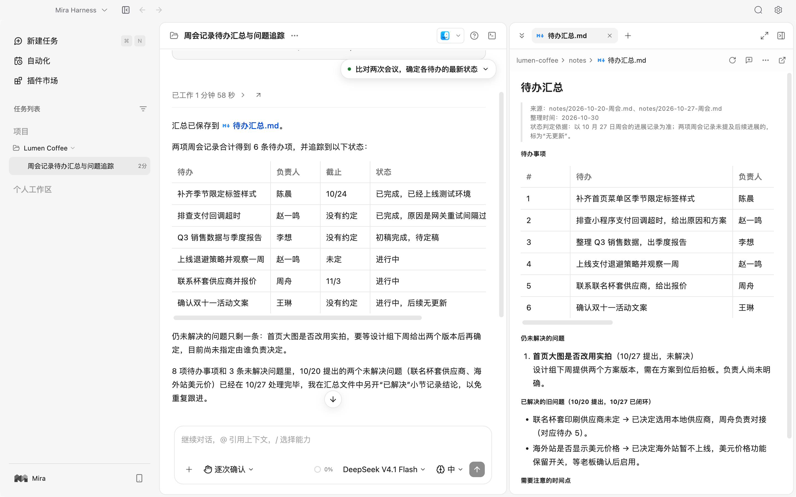

</div>

## 简介

告诉 Mira 你的目标，选择模型与权限，它会先给出计划，再调用文件、终端、浏览器和插件逐步执行。涉及修改文件或运行命令时，由你确认后才继续；整个过程随时可以查看、打断或回到之前的会话接着做。

会话、配置、记忆与运行记录保存在本机。你可以接入在线模型服务商，也可以只用本地 Ollama。

- **一个窗口完成任务**：对话旁边就是文件树、代码与文档预览、终端和内置浏览器，不用来回切换应用。
- **执行过程看得见**：计划、工具调用、文件改动和审批请求都显示在会话里，可以回退文件改动。
- **能力可以扩展**：插件市场、Skills、Hooks、自定义智能体和 MCP 服务都能按项目启用。
- **重复的事交给工作流**：把多步任务编排成工作流，定时运行，保留每次的产物。

## 功能一览

### 任务与智能体协作

按项目和分组管理会话。智能体先列出计划，再逐步调用工具；需要修改文件或执行命令时会停下来等你审批。复杂任务可以拆给子智能体并行处理，执行中途随时停止。

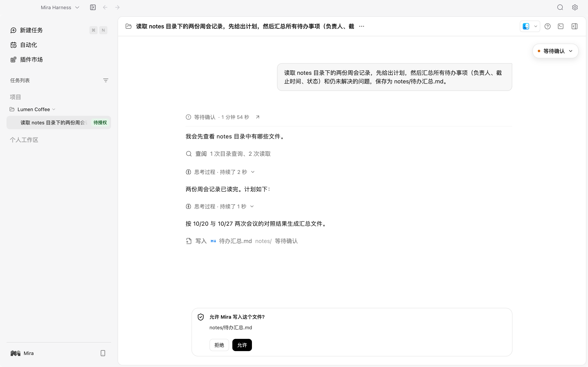

### 文件、终端与浏览器

在对话旁浏览、搜索和编辑项目文件，查看 Git 改动，打开终端，或让智能体在内置浏览器里操作网页。

<table>
  <tr>
    <td width="50%">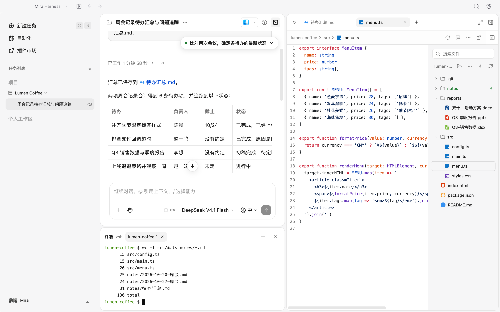</td>
    <td width="50%">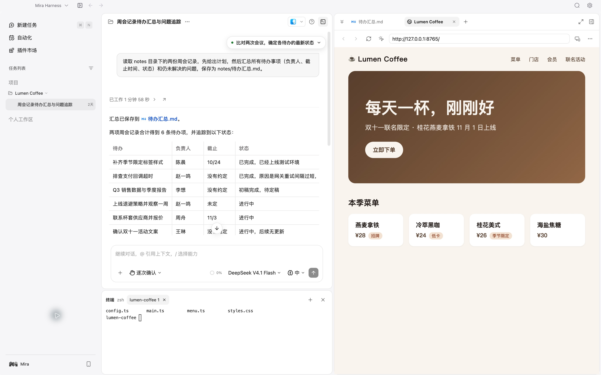</td>
  </tr>
  <tr>
    <td align="center">文件树、代码预览与 Git 改动</td>
    <td align="center">内置浏览器与终端</td>
  </tr>
</table>

### 文档预览与处理

直接预览 PDF、Word、Excel 和 PPT，配合文档插件生成或改写内容。

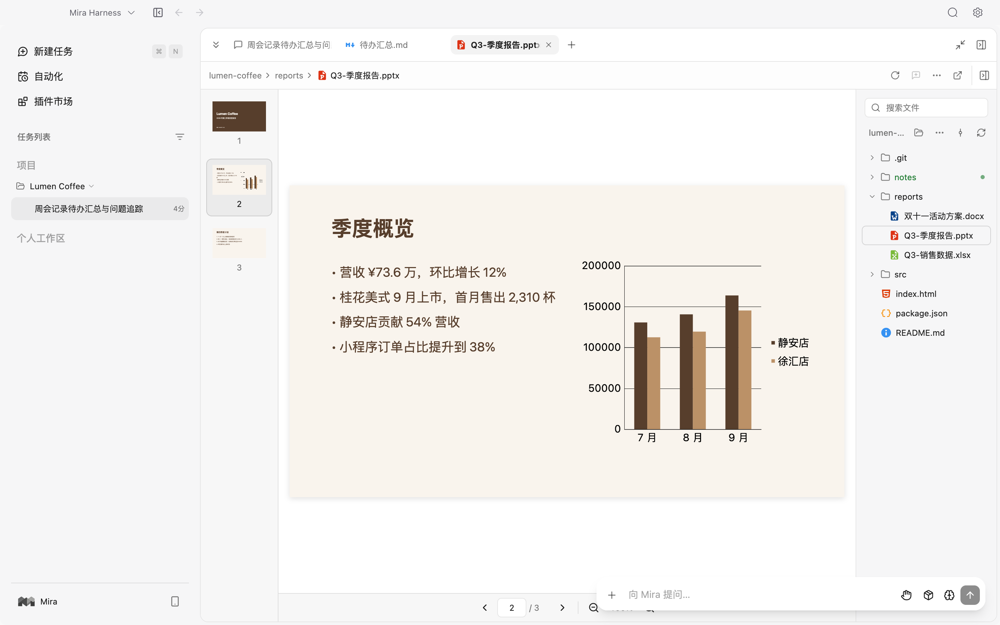

### 工作流与自动化

把“读取资料、提取要点、生成报告”这类多步任务编排成可重复运行的工作流，设置定时触发，查看每次的运行历史和产物。

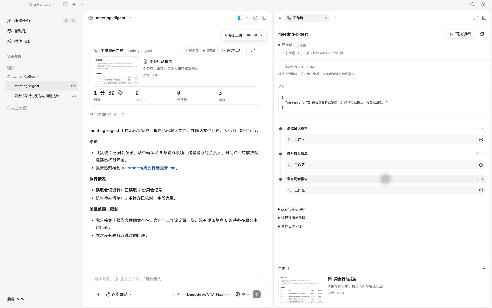

### 多模型接入

配置在线服务商、自定义兼容端点或本地 Ollama，每个任务可以单独选择模型。支持 OpenAI Completions、OpenAI Responses 与 Anthropic Messages 三种协议。

<table>
  <tr>
    <td width="50%">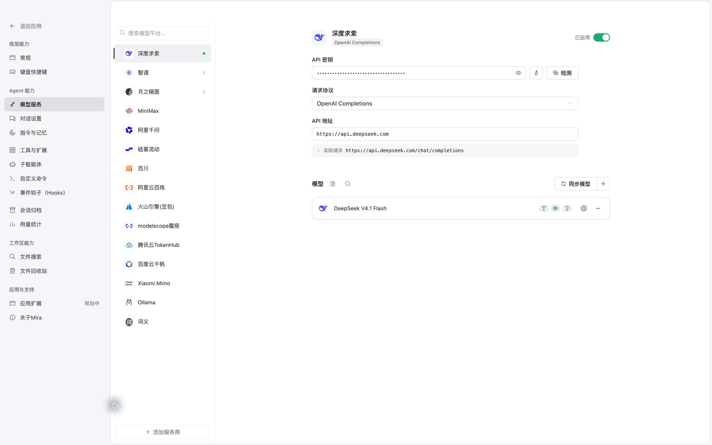</td>
    <td width="50%">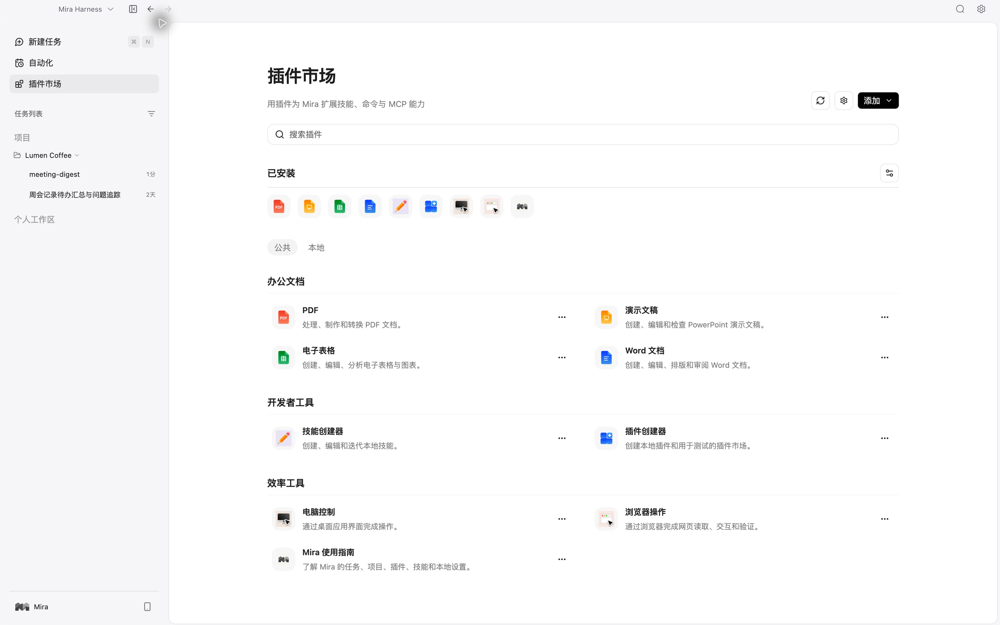</td>
  </tr>
  <tr>
    <td align="center">模型服务配置</td>
    <td align="center">插件市场与 MCP</td>
  </tr>
</table>

### 插件、Skills 与 MCP

通过插件市场安装 Skills、命令、智能体和 Hooks，接入外部 MCP 服务。内置插件包括 PDF、Word、表格、演示文稿、浏览器操作和电脑控制。

### 局域网远程对话

在可信局域网内，用手机或其他电脑的浏览器继续项目对话，任务仍由桌面端执行。该功能默认关闭。

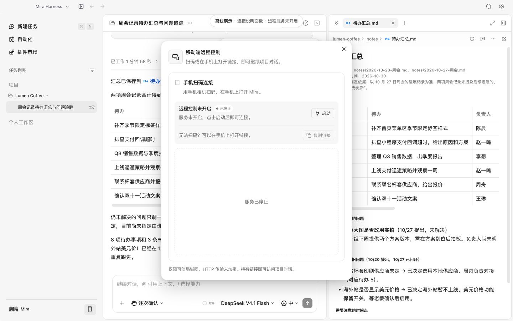

## 快速开始

### 下载安装

前往 [GitHub Releases](https://github.com/ChatWw/Mira-Harness/releases) 下载安装包。

| 平台 | 架构 | 安装包 |
| --- | --- | --- |
| macOS | Apple Silicon（arm64） | DMG |
| Windows | x64 | NSIS 安装程序 |

各版本实际提供的平台以发行页附件为准。暂无安装包时，可以[从源码运行](#本地开发)。

### 开始第一个任务

1. 打开 **设置 → 模型服务**，添加服务商或本地 Ollama，启用要用的模型。
2. 添加一个项目文件夹，或在个人工作区新建任务。
3. 选择模型与权限模式，描述你的目标。
4. 查看计划与执行过程，按提示审批，拿到结果后继续对话。

可以试试这些说法：

> 读取这个项目里的会议记录，整理待办事项、负责人和未解决的问题，保存成一份 Markdown 文档。

> 帮我梳理这个仓库的启动流程，找出配置入口，先给出修改计划，等我确认后再动手。

> 把“读取资料、提取要点、生成报告”整理成可重复运行的工作流，并保留每次运行的结果。

PDF、Office、浏览器操作等插件可能需要额外的 Python 库或浏览器，启用前请查看插件说明。macOS 上的电脑控制需要授予辅助功能与屏幕录制权限。

## 架构

Mira 的执行能力和数据都由 Electron 主进程持有。界面层只负责展示和交互，通过受控通道调用宿主能力，拿不到模型密钥，也不能直接访问完整的 preload。

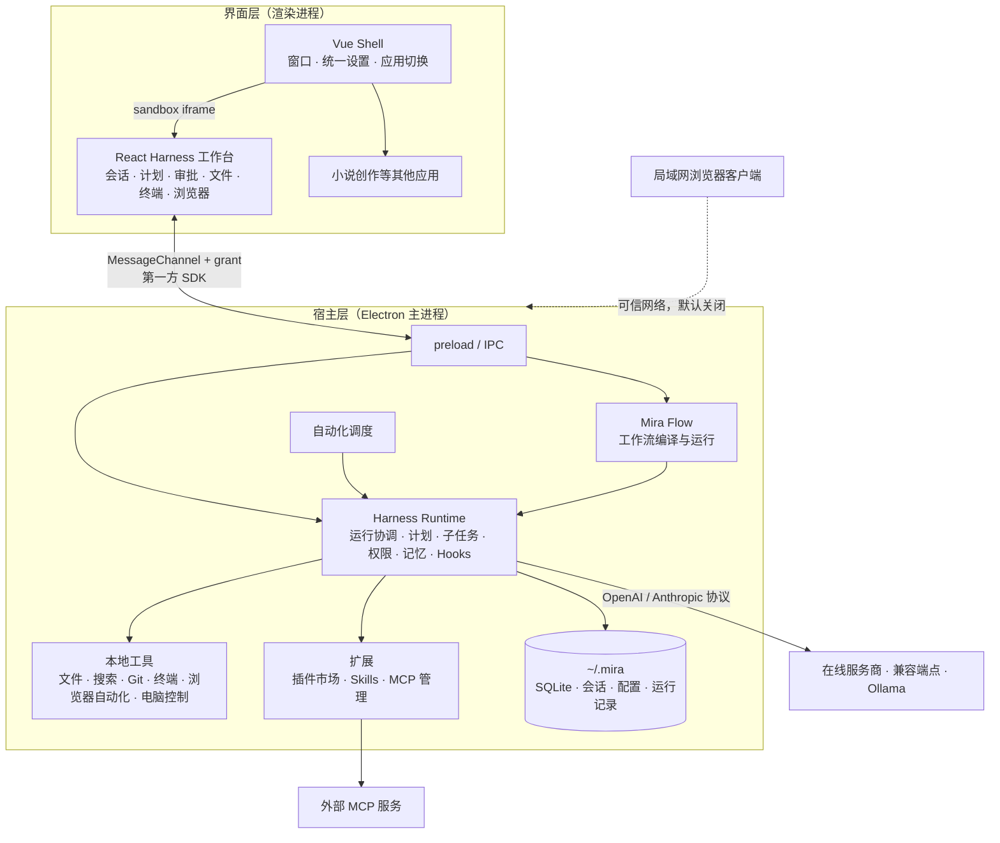

### 一次任务的执行过程

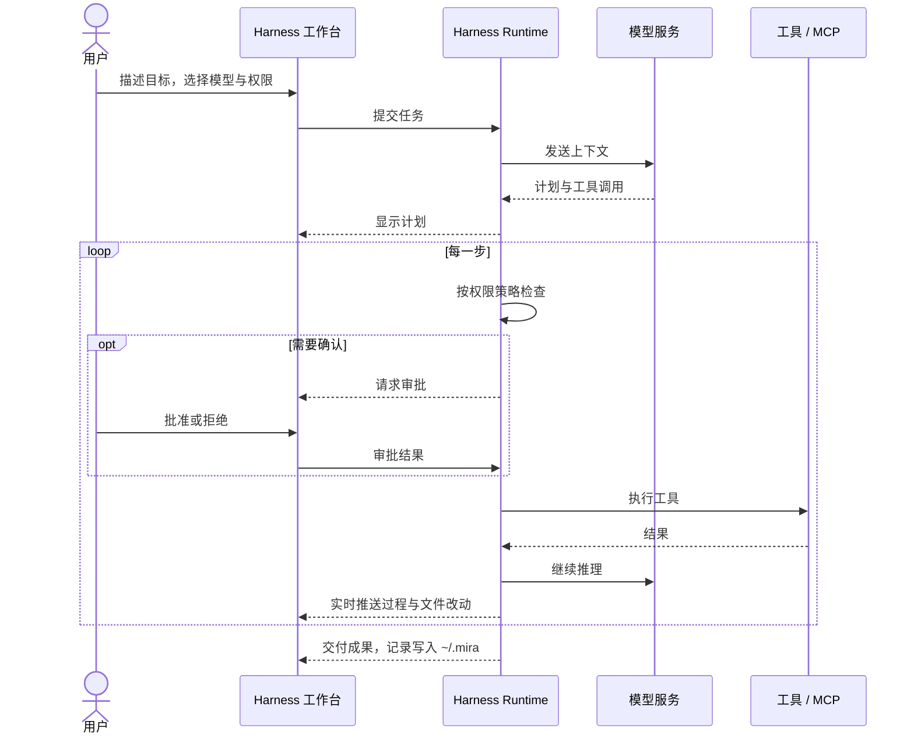

### 技术栈

| 层 | 技术 |
| --- | --- |
| 桌面宿主 | Electron · TypeScript · better-sqlite3 · node-pty |
| 工作台 | React 19 · Tailwind CSS 4 · Radix UI · xterm.js · Shiki |
| 外壳与设置 | Vue 3 · Pinia · Element Plus · Wujie |
| 智能体与扩展 | pi-agent-core · Model Context Protocol SDK |
| 文档预览 | pdf.js · docx-preview · pptx-renderer |
| 构建与测试 | electron-vite · Vite · electron-builder · Vitest |

### 目录结构

```text
apps/harness-react/    React 工作台、局域网客户端与宿主桥
electron/              主进程、preload、IPC、执行服务与存储
src/                   Vue Shell、设置、小说页面与共享契约
packages/              工作流编译器（mira-flow-kit）与运行时（mira-flow-runtime）
resources/             随应用分发的插件与运行资源
scripts/               构建及安装准备脚本
tests/                 功能回归测试
docs/                  能力说明与接口文档
third-party-licenses/  第三方许可、通知与来源记录
```

更详细的设计见[产品定位](PRODUCT.md)与 [React 工作台结构](apps/harness-react/README.md)。

## 数据与隐私

- **保存在本机**：会话、配置、记忆和运行记录保存在用户目录下的 `.mira` 中，项目文件留在你选择的目录。
- **只发给你配置的服务商**：调用在线模型时，任务相关的消息、附件内容或工具结果会随请求发送给对应服务商。只用本地 Ollama 时不经过外部模型服务。
- **外部能力按需启用**：插件和 MCP 服务可能访问网络或其他应用，数据处理取决于你启用的工具。
- **权限由你决定**：文件、命令和工具调用都经过权限策略与审批，具体边界见[文件访问说明](docs/MIRA_FILE_ACCESS.md)。

局域网远程对话默认关闭，启用后模型与执行能力仍在这台电脑上。请只在可信网络中使用，连接范围见[远程对话说明](docs/MIRA_LAN_REMOTE_IMPLEMENTATION.md)。

## 本地开发

本仓库工程名为 **Mira Harness**，应用名为 **Mira**。

**环境要求**

- Node.js **22.12 或更高版本**及 npm
- macOS：Xcode Command Line Tools（用于编译电脑控制辅助程序）
- Windows：安装包需在 Windows 上构建，原生依赖需要对应平台的编译工具链

```bash
git clone https://github.com/ChatWw/Mira-Harness.git
cd Mira-Harness
npm install
npm run dev
```

`npm run dev` 会先构建 React 工作台、工作流运行时和本地工具，再启动 Electron。修改 React 工作台源码后，运行 `npm run harness:build` 再刷新桌面页面即可。

<details>
<summary><b>全部命令</b></summary>

| 命令 | 用途 |
| --- | --- |
| `npm run dev` | 准备资源并启动 Electron 开发环境 |
| `npm run build` | Vue / React 类型检查和完整生产构建 |
| `npm test` | 运行 Vitest 回归测试 |
| `npm run desktop:build` | 构建 macOS arm64 DMG |
| `npm run desktop:build:win` | 在 Windows 上构建 x64 NSIS 安装包 |
| `npm run harness:build` | 单独重建 React 工作台及远程客户端 |
| `npm run flow:build` | 单独重建工作流编译器与运行时 |
| `npm run tools:build` | 准备搜索工具及电脑控制辅助程序 |

两个安装包命令都包含类型检查和生产构建，本地工具在打包时按目标平台与架构准备。

</details>

## 路线图

- [x] Harness 工作台：会话、计划、审批、子智能体、文件与终端
- [x] 多模型接入：在线服务商、兼容端点、本地 Ollama
- [x] 插件市场、Skills、Hooks 与 MCP
- [x] 工作流编排与定时自动化
- [x] 局域网远程对话
- [ ] Windows 安装包完整验收
- [ ] 接入 Mira Novel Studio
- [ ] Mira Vision

## 常见问题

<details>
<summary><b>不想把数据发给在线服务商，可以用吗？</b></summary>

可以。在 **设置 → 模型服务** 中接入本地 Ollama，模型调用就只在本机进行。注意部分插件或 MCP 服务本身可能联网。

</details>

<details>
<summary><b>支持哪些模型？</b></summary>

任何提供 OpenAI Completions、OpenAI Responses 或 Anthropic Messages 协议的服务商或自建端点都可以接入。智能体任务需要模型支持工具调用，能力较弱的模型可能无法完成多步任务。

</details>

<details>
<summary><b>数据存在哪里？</b></summary>

会话、配置、记忆和运行记录在用户目录下的 `~/.mira`，项目文件保留在你自己选择的目录。

</details>

<details>
<summary><b>PDF、Office 插件提示缺少依赖怎么办？</b></summary>

这些插件依赖 Python 库或浏览器等外部工具，请按插件说明安装后重新启用。

</details>

<details>
<summary><b>macOS 上电脑控制不起作用？</b></summary>

需要在 **系统设置 → 隐私与安全性** 中为 Mira 打开“辅助功能”和“屏幕录制”权限，然后重启应用。

</details>

## 文档

| 主题 | 入口 |
| --- | --- |
| 产品与界面 | [产品定位](PRODUCT.md) · [界面规范](DESIGN.md) |
| 工作台与应用接入 | [React 工作台结构](apps/harness-react/README.md) · [第一方 SDK](docs/MIRA_FIRST_PARTY_SDK_CONTRACT.md) |
| 模型与文件 | [内置模型协议](docs/BUILTIN_MODEL_PROTOCOLS.md) · [文件访问](docs/MIRA_FILE_ACCESS.md) |
| 工具与扩展 | [内置浏览器自动化](docs/MIRA_EMBEDDED_BROWSER_AUTOMATION.md) · [插件市场](docs/MIRA_PLUGIN_MARKETPLACE.md) |
| 远程使用 | [局域网远程对话](docs/MIRA_LAN_REMOTE_IMPLEMENTATION.md) |

## 参与贡献

欢迎提交 [Issue](https://github.com/ChatWw/Mira-Harness/issues) 和 Pull Request。

- **报告问题**：请附上应用版本、操作系统、复现步骤，以及必要的截图或已脱敏日志。
- **提交代码**：提交前运行 `npm run build` 与 `npm test`，并在 PR 中说明改动和验证方式。

<a href="https://github.com/ChatWw/Mira-Harness/graphs/contributors">
  
</a>

## 致谢

Mira 使用了许多优秀的开源项目，包括 [Electron](https://www.electronjs.org/)、[React](https://react.dev/)、[Vue](https://vuejs.org/)、[Model Context Protocol](https://modelcontextprotocol.io/)、[xterm.js](https://xtermjs.org/)、[Shiki](https://shiki.style/)、[ripgrep](https://github.com/BurntSushi/ripgrep) 等。部分内置插件改编自 [openai/skills](https://github.com/openai/skills)。完整来源与许可声明见 [third-party-licenses](third-party-licenses/README.md) 及 [插件来源记录](resources/plugins/UPSTREAM-SOURCES.json)。

## Star History

<a href="https://star-history.com/#ChatWw/Mira-Harness&Date">
  <picture>
    <source media="(prefers-color-scheme: dark)" srcset="https://api.star-history.com/svg?repos=ChatWw/Mira-Harness&type=Date&theme=dark" />
    
  </picture>
</a>

## 开源许可

Mira 原创代码采用 [MIT License](LICENSE)。项目使用的第三方代码、素材和依赖遵循各自的许可证。
